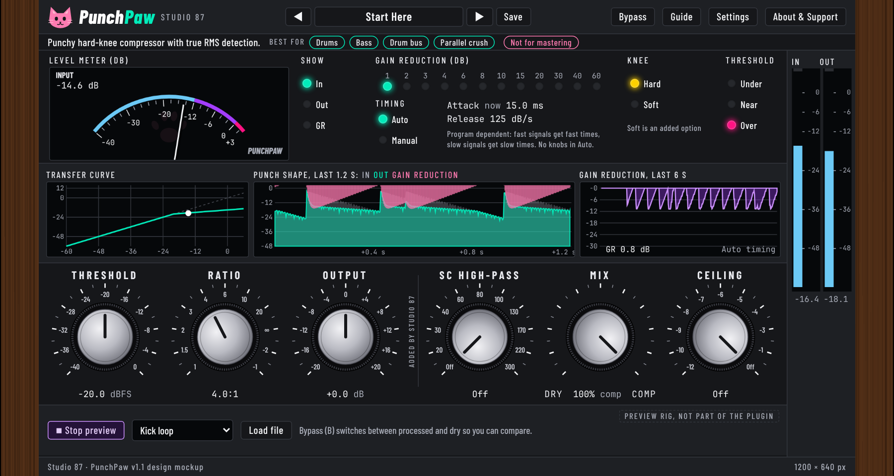

# PunchPaw

A free, open source, cat-themed kick and drum limiter/compressor (VST3, Linux first): threshold, compression and output gain with program-dependent timing, plus optional manual attack and release.

The interactive design mockup (screenshot). The plugin window will follow it exactly.

## Status
Design mockup only. The interactive mockup in `docs/mockup/` runs a WebAudio preview of the planned behaviour. The plugin itself is not built yet; the approved mockup will be ported natively to JUCE (VST3, Linux first). No manual yet: it ships with the plugin.

## Try the mockup
Open `docs/mockup/PunchPaw.html` in a browser. Nothing is sent anywhere; it works offline (fonts load from Google Fonts when online, with a fallback).

## Controls in the mockup
Attack, Release, Threshold, Ratio, Output, SC High-pass, Mix, Ceiling

Every control has a hover info bubble (64 in total).

## Privacy
Collects nothing. No network access.

## Support

  

Free and open source, made by one person. If it helps your music, a coffee on [Ko-fi](https://ko-fi.com/studio87) keeps it coming.

## License
AGPL-3.0-or-later, see [LICENSE](LICENSE).
